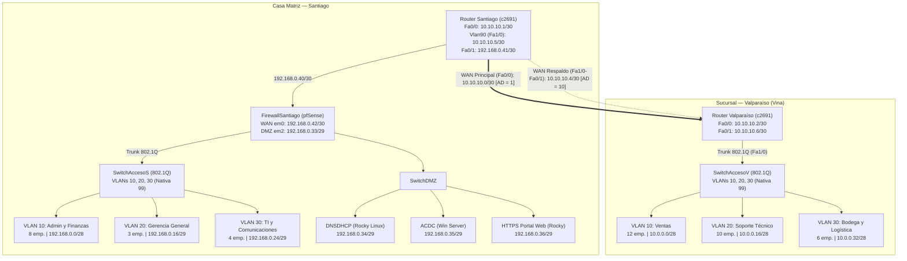

# Arquitectura de Red y Plan de Direccionamiento VLSM

## 1. Topología Lógica Integrada (Variante 9)

---

## 2. Tabla de Direccionamiento IP (VLSM)

| Sede | Segmento / Departamento | Dotación | VLAN | Subred y Prefijo | Máscara | Gateway | Rango DHCP / Asignación |
| :--- | :--- | :---: | :---: | :--- | :--- | :--- | :--- |
| **Casa Matriz** | Administración y Finanzas | 8 | `10` | `192.168.0.0/28` | `255.255.255.240` | `192.168.0.1` | `.2` – `.14` (DHCP Relay) |
| **Casa Matriz** | Gerencia General | 3 | `20` | `192.168.0.16/29` | `255.255.255.248` | `192.168.0.17` | `.18` – `.22` (DHCP Relay) |
| **Casa Matriz** | TI y Comunicaciones | 4 | `30` | `192.168.0.24/29` | `255.255.255.248` | `192.168.0.25` | `.26` – `.30` (DHCP Relay) |
| **Casa Matriz** | DMZ Servidores | 3 srv | `1` (DMZ) | `192.168.0.32/29` | `255.255.255.248` | `192.168.0.33` | Estáticas: `.34` DNS/DHCP, `.35` ACDC, `.36` HTTP |
| **Casa Matriz** | Tránsito Router $\leftrightarrow$ pfSense | P2P | — | `192.168.0.40/30` | `255.255.255.252` | — | `.41` (`Santiago`), `.42` (`FirewallSantiago`) |
| **Sucursal** | Ventas | 12 | `10` | `10.0.0.0/28` | `255.255.255.240` | `10.0.0.1` | `.2` – `.14` (`ip helper-address 192.168.0.34`) |
| **Sucursal** | Soporte Técnico | 10 | `20` | `10.0.0.16/28` | `255.255.255.240` | `10.0.0.17` | `.18` – `.30` (`ip helper-address 192.168.0.34`) |
| **Sucursal** | Bodega y Logística | 6 | `30` | `10.0.0.32/28` | `255.255.255.240` | `10.0.0.33` | `.34` – `.46` (`ip helper-address 192.168.0.34`) |
| **WAN** | Enlace Principal (AD=1) | P2P | — | `10.10.10.0/30` | `255.255.255.252` | — | `.1` (`Santiago Fa0/0`), `.2` (`Valparaíso Fa0/0`) |
| **WAN** | Enlace Respaldo (AD=10) | P2P | `90`/L3 | `10.10.10.4/30` | `255.255.255.252` | — | `.5` (`Santiago Vlan90`), `.6` (`Valparaíso Fa0/1`) |

---

## 3. Justificación de Escalabilidad y Seguridad

1. **Escalabilidad (Proyección de 3ª sucursal en 12 meses):**
   - Casa Matriz utiliza el bloque `192.168.0.0/24` y la Sucursal Valparaíso utiliza `10.0.0.0/24` (usando apenas hasta `.47`), dejando disponible `10.0.1.0/24` (o el resto de `10.0.0.0/16`) y `10.10.10.8/30` para conectar una tercera sucursal replicando exactamente la plantilla de router + switch 802.1Q + `ip helper-address`.
2. **Mitigación del problema operativo del cliente (ACLs):**
   - `ACL_SOPORTE_IN` bloquea transferencias directas desde **Soporte Técnico** hacia **Ventas** y **Administración/Finanzas**, eliminando la saturación reportada por gerencia sin impedir que Soporte acceda al DNS y al portal corporativo HTTP.
   - `ACL_BODEGA_IN` restringe el acceso de **Bodega y Logística** hacia **Gerencia General** y el controlador **ACDC**, aplicando privilegio mínimo.
3. **Alta disponibilidad WAN (Variante 9):**
   - Dos caminos físicos y de Capa 3 independientes entre sedes con **rutas estáticas flotantes** (`AD = 1` vs `AD = 10`), garantizando continuidad ante corte del enlace principal sin bucles de enrutamiento.
