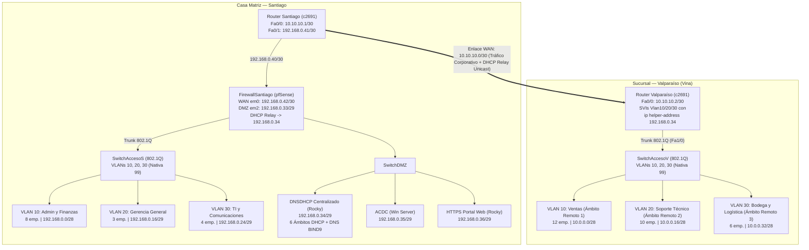

# Arquitectura de Red, Ámbitos DHCP y Plan VLSM (Equipo 1)

## 1. Topología Lógica Integrada — Variante 1 (DHCP Centralizado entre Sedes)

---

## 2. Tabla de Direccionamiento IP (VLSM) y Ámbitos DHCP Centralizados

Todos los ámbitos dinámicos son administrados centralmente desde **`DNSDHCP` (`192.168.0.34`)** en la DMZ de Casa Matriz:

| Sede | Departamento / Segmento | Dotación | VLAN | Subred y Prefijo | Gateway (`option routers`) | Pool DHCP (`range`) | Mecanismo DHCP |
| :--- | :--- | :---: | :---: | :--- | :--- | :--- | :--- |
| **Sucursal** | **Ventas (Ámbito Remoto 1)** | 12 | `10` | `10.0.0.0/28` | `10.0.0.1` | `10.0.0.2 – 10.0.0.14` | `ip helper-address 192.168.0.34` |
| **Sucursal** | **Soporte Técnico (Ámbito Remoto 2)** | 10 | `20` | `10.0.0.16/28` | `10.0.0.17` | `10.0.0.18 – 10.0.0.30` | `ip helper-address 192.168.0.34` |
| **Sucursal** | **Bodega y Logística (Ámbito Remoto 3)** | 6 | `30` | `10.0.0.32/28` | `10.0.0.33` | `10.0.0.34 – 10.0.0.46` | `ip helper-address 192.168.0.34` |
| **Casa Matriz** | Administración y Finanzas | 8 | `10` | `192.168.0.0/28` | `192.168.0.1` | `192.168.0.2 – 192.168.0.14` | DHCP Relay en `FirewallSantiago` |
| **Casa Matriz** | Gerencia General | 3 | `20` | `192.168.0.16/29` | `192.168.0.17` | `192.168.0.18 – 192.168.0.22` | DHCP Relay en `FirewallSantiago` |
| **Casa Matriz** | TI y Comunicaciones | 4 | `30` | `192.168.0.24/29` | `192.168.0.25` | `192.168.0.26 – 192.168.0.30` | DHCP Relay en `FirewallSantiago` |
| **Casa Matriz** | DMZ Servidores | 3 srv | `1` | `192.168.0.32/29` | `192.168.0.33` | Estáticas: `.34` DNS/DHCP, `.35` ACDC, `.36` HTTP | IP Estática |
| **Casa Matriz** | Tránsito Router $\leftrightarrow$ pfSense | P2P | — | `192.168.0.40/30` | — | `.41` (`Santiago`), `.42` (`FirewallSantiago`) | IP Estática |
| **WAN** | Enlace Inter-Sedes | P2P | — | `10.10.10.0/30` | — | `.1` (`Santiago Fa0/0`), `.2` (`Valparaíso Fa0/0`) | IP Estática |

---

## 3. Funcionamiento Técnico de la Variante 1 (DHCP Relay entre Sedes)

1. **Descubrimiento local (Broadcast L2):** El cliente en VLAN 10 (`Ventas`) o VLAN 20 (`Soporte`) de Valparaíso envía un `DHCPDISCOVER` a `255.255.255.255` (UDP 68 $\rightarrow$ 67).
2. **Intercepción y Relay (`giaddr`):** La interfaz `Vlan10` (`10.0.0.1`) o `Vlan20` (`10.0.0.17`) del router `Valparaiso` recibe el broadcast, inserta su propia IP en el campo **`giaddr`** (*Gateway IP Address*) del paquete DHCP y lo encapsula como **unicast** hacia `192.168.0.34` cruzando el enlace WAN `10.10.10.0/30`.
3. **Selección de ámbito en Casa Matriz:** El servidor `DNSDHCP` (`192.168.0.34`) lee el campo `giaddr` (`10.0.0.1` vs `10.0.0.17`), selecciona el ámbito correspondiente (`10.0.0.0/28` o `10.0.0.16/28`) y responde con `DHCPOFFER` / `DHCPACK` incluyendo `option routers` (gateway de esa VLAN), `domain-name-servers` (`192.168.0.34`) y `domain-name` (`technomarket.cl`).
4. **Convivencia con ACLs:** En `Vina_variante1.cfg`, `ACL_SOPORTE_IN` y `ACL_BODEGA_IN` incluyen explícitamente `permit udp any eq bootpc any eq bootps` al inicio para que las restricciones de seguridad departamental nunca bloqueen la concesión inicial (`0.0.0.0:68 -> 255.255.255.255:67`) ni la renovación DHCP.
